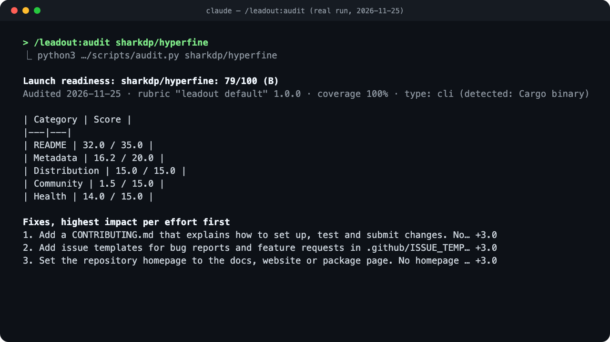

# leadout

[](LICENSE)
[](CHANGELOG.md)
[](#requirements)

The lead-out train for your repo.

A Claude Code plugin that takes a GitHub repository from finished code to launched and measured: audit, fixes, visuals, launch kit and post-launch stats.



## Install

```bash
claude plugin marketplace add cc-forge/leadout && claude plugin install leadout@leadout
```

Inside a Claude Code session the same thing is:

```text
/plugin marketplace add cc-forge/leadout
/plugin install leadout@leadout
```

### Try it from a local checkout

Start Claude Code from the plugin folder, then type the commands **inside the Claude
session**, not in your shell (a shell reads `<` and `>` as redirections):

```bash
cd leadout
claude --plugin-dir .
```

```text
/leadout:audit sharkdp/hyperfine
```

Replace the example target with your own repository (`owner/name`, a GitHub URL or a
local path). Without a target the commands work on the current directory.

## Commands

| Command | What it does | Writes |
|---|---|---|
| `/leadout:audit [owner/repo \| URL \| path]` | Deterministic 0-100 launch-readiness score over 24 checks (README, metadata, distribution, community, health), with fixes ranked by impact per effort | nothing |
| `/leadout:fix [path]` | Turns the audit into a plan: README rewrite per project type, badges that are checked before use, topics, CONTRIBUTING, code of conduct, security policy, issue and PR templates, CI for the detected language, release notes from Conventional Commits | new files on a new branch, after you approve each step |
| `/leadout:visuals [path]` | Storyboard for a demo GIF's first 5 seconds, recording and compression commands (under 5 MB), a 1280x640 social preview and a light/dark banner | new image files |
| `/leadout:launch [path]` | A `launch/` folder with Show HN, Reddit, X thread, dev.to, awesome lists, calendar, launch-day checklist and answers to likely objections, plus a lint for the platform rules | `launch/` only |
| `/leadout:stats [owner/repo \| path]` | Stars, forks, watchers, 14-day views and clones, referrers, popular pages and release downloads, kept in a local history with a before/after launch comparison | `.leadout/` only |
| `/leadout:all [path]` | Audit, fix, visuals and launch kit in order, asking before each phase | as each phase |

You can also ask in plain words ("audit this repo", "write my launch posts"): Claude
picks the matching skill.

## What an audit looks like

Real output of `/leadout:audit sharkdp/hyperfine`, run on 2026-11-25:

```text
# Launch readiness: sharkdp/hyperfine: 79/100 (B)

Audited 2026-11-25 · rubric "leadout default" 1.0.0 · coverage 100% · type: cli (detected: Cargo binary)

| Category | Score |
|---|---|
| README | 32.0 / 35.0 |
| Metadata | 16.2 / 20.0 |
| Distribution | 15.0 / 15.0 |
| Community | 1.5 / 15.0 |
| Health | 14.0 / 15.0 |
```

The same day `psf/requests` scored 75/100 (library) and `localsend/localsend` scored
83/100 (desktop app). Checks without data (offline, no remote, no push access) are left
out of the score and reported as coverage, so missing data never looks like a failing
repository. The rubric lives in [`scripts/rubric.json`](scripts/rubric.json) and can be
overridden per repository in `.leadout/rubric.json`.

## Case study

Before and after numbers of a real launch, filled in by the author:

| | Before | After |
|---|---|---|
| Audit score | TODO(score before) | TODO(score after) |
| Stars | TODO(stars before) | TODO(stars after, with dates) |
| Unique visitors, 14 days | TODO(visitors before) | TODO(visitors after) |
| Top referrer | TODO(referrer before) | TODO(referrer after) |

## Project rules

These are choices of the project, not settings:

- It never asks anyone for votes, upvotes or stars, and never suggests star exchanges.
- It never suggests multiple accounts, and never writes the same post for several
  communities: each subreddit gets its own text, and the lint flags near-duplicates.
- It writes texts only. It never publishes, posts or submits anything on any platform.
- It always asks before writing to an existing file, committing, pushing, changing
  repository metadata or creating a release. The plugin's permissions pre-approve only
  the read-only scripts and the drafts inside `launch/`; every other write, commit or
  push goes through Claude Code's own permission prompt as well.
- It never invents numbers, features, benchmarks, users or press: a missing fact becomes
  a visible `TODO(...)`, and every phase lists the ones left.

GitHub has no API to upload a repository's social preview, so `/leadout:visuals`
makes the image and tells you where to upload it: the repository's Settings page, under
"Social preview" (PNG, JPG or GIF under 1 MB; 1280x640 recommended).

## Requirements

- Python 3.9 or newer, standard library only: nothing to install.
- [GitHub CLI](https://cli.github.com/) (`gh`), signed in with `gh auth login`.
- Optional: `ffmpeg` or `gifski` for GIF compression; `rsvg-convert`, Inkscape,
  ImageMagick or Google Chrome to turn SVG into PNG.

## Privacy

- No telemetry. The plugin sends nothing anywhere on its own.
- Every GitHub call goes through your own `gh`; the scripts never read, print or store
  your token.
- The only other network call checks that a badge URL answers before it goes into your
  README; it is off with `--offline`.
- The stats history stores counts only, never the usernames of stargazers.

## Development

```bash
python3 -m unittest discover -s tests
```

The tests run without network: GitHub responses are recorded fixtures from real public
repositories. [SPEC.md](SPEC.md) is the full specification.

## Roadmap

- Subreddit rules in `templates/launch/subreddits.json`, read from each community's live
  rules page (empty today: Reddit refused automated reads, and rules are never guessed).
- Traffic and stargazer fixtures from a repository with push access.
- More CI templates beyond Python, Node, Go and Rust.

## Contributing

Issues and pull requests are welcome. See [CONTRIBUTING.md](CONTRIBUTING.md) for setup,
tests and the pull request flow, and [SECURITY.md](SECURITY.md) to report a
vulnerability privately.

## License

[MIT](LICENSE)
